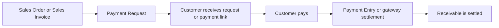
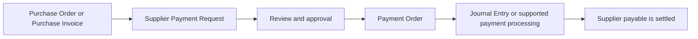

A Payment Request records that a specific amount needs to be paid. It is a request or instruction, not proof that money has moved, so creating it does not post to the General Ledger.

For a Customer, create an inward Payment Request from a submitted [Sales Order](/erpnext/sales-order) or [Sales Invoice](/erpnext/sales-invoice). ERPNext can email the request with an online payment link when a [Payment Gateway Account](/erpnext/payment-gateway-account) is configured, or you can use it to communicate offline bank-transfer instructions.

For a Supplier, an outward Payment Request can become the internal instruction that an approved [Purchase Order](/erpnext/purchase-order) or [Purchase Invoice](/erpnext/purchase-invoice) should be paid. The finance team can later collect approved Supplier Payment Requests in a [Payment Order](/erpnext/payment-order).

Use Payment Request when you need to ask for payment, send a payment link, request an advance, or introduce an approval step before paying a Supplier. If money has already been received or paid and you only need to record it, create a [Payment Entry](/erpnext/payment-entry) directly.

## Before you begin

Confirm the correct Company, currency, receivable or payable account, and bank or cash ledger. Use submitted source documents and keep the bank reference or remittance advice available.

## Create a Customer Payment Request

1. Open the submitted Sales Order or Sales Invoice.
2. Choose **Create &gt; Payment** to create the Payment Request.

3. Confirm the amount, currency, recipient, and reference document.

4. Select the payment gateway account when collecting online.
5. Save and send the request.
6. Track its status and verify the resulting payment before treating the source document as paid.

## Request a Supplier payment

1. Open the submitted Purchase Order or Purchase Invoice that should be paid.
2. Create an outward Payment Request.
3. Confirm the Supplier, amount, Company bank details, and supporting reference.

4. Submit the request according to your approval process.
5. Add the approved request to a Payment Order, or process the payment through the supported accounting workflow.

## Watch Video

<iframe src="https://www.youtube.com/embed/CRrEiA2Myj4" title="Payment Request in ERPNext" allow="accelerometer; autoplay; clipboard-write; encrypted-media; gyroscope; picture-in-picture; web-share" frameborder="0" allowfullscreen></iframe>

## Important fields and what they mean

| Field                   | What it controls                                                     |
| ----------------------- | -------------------------------------------------------------------- |
| Payment Request Type    | Inward for Customer receipts or Outward for supported payment flows. |
| Reference Document      | Sales Order, Sales Invoice, or another supported source.             |
| Grand Total             | Amount requested.                                                    |
| Currency                | Currency presented to the payer.                                     |
| Payment Gateway Account | Gateway and settlement account used for online collection.           |
| Status                  | Tracks initiation, request, and payment state.                       |

## What happens after you submit or process

Submitting a Payment Request records and communicates the request. It does not, by itself, settle the invoice or post a bank transaction. For a Customer request, the accounting impact occurs when the gateway completes the payment or a Payment Entry is recorded. For a Supplier request, the accounting impact occurs only when the approved payment is processed through the resulting accounting document.

## Troubleshooting

### The recipient email address is blank or incorrect

Check the Contact linked to the Customer and confirm that it has the correct email address. Select or correct **Email To** before sending. Use one valid recipient address when the payment provider accepts only a single payer email.

### Submitting or sending the request times out

Test the outgoing [Email Account](/framework/email-account) separately. Incorrect SMTP host, port, SSL, or STARTTLS settings can make the request appear to hang while ERPNext tries to send the message. Review the Email Queue and Error Log before resending.

### The customer paid, but the request still shows Initiated

Verify the transaction in the payment provider first. Then check the [Payment Gateway Account](/erpnext/payment-gateway-account), webhook or callback configuration, site URL, and Error Log. Do not manually mark a request paid until the actual settlement and resulting accounting entry have been verified.

### The payment link does not open or uses the wrong gateway

Confirm that the selected gateway account is enabled, belongs to the correct Company, supports the transaction currency, and has valid credentials. Generate a fresh request after correcting the configuration rather than editing a link already sent to the customer.

## Frequently asked questions

### Does a Payment Request itself post to the General Ledger?

A Payment Request does not post to the ledger. It records and communicates the request. The ledger is affected when the successful payment creates or is recorded through the appropriate Payment Entry or gateway transaction.

### Can I request only part of an invoice or order amount?

A partial amount can be requested when the source workflow and gateway support it. Confirm the remaining outstanding amount afterward and avoid sending overlapping active requests for the same portion.

### Can I customize the email sent with the request?

The available message comes from the Payment Request and gateway configuration in your version. Review the generated subject, body, recipient, and print format before sending. Use supported templates or a controlled customization when the standard message is insufficient.

### Can a Payment Request be used without an online gateway?

It can still document an offline request, but it will not automatically collect money. Share the relevant payment instructions, then record the receipt with a Payment Entry and verify it against the source document.

### Should I send another request when a customer says the first link failed?

First check whether the original request or provider transaction succeeded. If it did not, correct the configuration and create or resend a valid request. Avoid multiple active links that could let the customer pay the same amount twice.

## Related topics

- [Payment Entry](/erpnext/payment-entry)
- [Payment Reconciliation](/erpnext/payment-reconciliation)
- [Bank Reconciliation](/erpnext/bank-reconciliation)
- [Bank Transaction](/erpnext/bank-transaction)
- [Journal Entry](/erpnext/journal-entry)