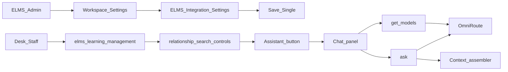

# [T-A06 | elms-knowledge-assistant-omniroute] PLAN

**Дата:** 2026-11-12  
**Режим:** APP PLAN → APP DECOMPOSE → APP IMPLEMENT  
**Уровень:** L2  
**Статус:** planned  
**Clarify:** `memory-bank/app/clarify/clarify-20261111-elms-knowledge-assistant-omniroute.md`  
**Prompt:** `md/prompt.md`  
**Queue:** `memory-bank/app/roadmap/queue.yaml` → `T-A06`  
**Batch:** `elms-knowledge-assistant`  
**Deps:** T-A02 (LMS Desk learning surface), T-A03 (Settings workspace / Admin access)  
**Related:** `memory-bank/product/modules.md`, `memory-bank/compliance/reestr-po-certification.md`, CRM pattern FCRM/Voice Settings Singles  
**SUSPENSION GUARD:** active — plan output unlimited (§0.0)

---

## Clarifications

Session: `clarify-20261111-elms-knowledge-assistant-omniroute` · Grill rounds=3 · Q=10 · status=done.

| Решение | Значение |
|---------|----------|
| Persona | Desk staff: Admin / Operations / Methodologist / Instructor (не Learner) |
| Entry | Кнопка в UI «Поиск по связям» (`.elms-relationship-search-controls`), не floating FAB |
| Registry | Optional capability; без OmniRoute ELMS полностью работает; ассистент fail-closed |
| Corpus | DocType JSON LMS/Core + `@frappe.whitelist` signatures `elms.lms.api` + короткий Frappe REST cheat sheet; без memory-bank prose |
| Config SoT | Single DocType `ELMS Integration Settings` (как Settings-окно CRM/ERP); **запрещён** dual-path fallback на site_config |
| Model | Live `get_models` + picker; default `cx/gpt-5.6-luna-high` |
| History | `sessionStorage` + bounded history в `ask`; без Chat DocType |
| Settings window | Отдельная Form `ELMS Integration Settings`; ссылка в Workspace Settings |
| Fields | `enabled`, `omniroute_base_url`, `omniroute_api_key` (Password), `default_model` |
| Settings RBAC | Write: `ELMS Admin` + `System Manager`; чат без выдачи секрета |

---

## Context consumed

| Path | Что вошло |
|------|-----------|
| Clarify Completion Report | Persona/surface/registry/corpus/config/model/history/settings |
| `elms/elms/public/js/desk-learning.js` | Relationship search controls — entrypoint ассистента |
| `elms/elms/desk/workspaces.py` | Settings workspace; platform `Integrations` скрыт |
| `elms/elms/elms_core/doctype/elms_settings_section/` | Только RBAC-якорь — не форма интеграций |
| `memory-bank/compliance/reestr-po-certification.md` | Запрет безальтернативного зарубежного LLM |
| Codex OmniRoute canon | `http://localhost:20128/v1`, key file `~/.codex/.omniroute_key`, model `cx/gpt-5.6-luna-*` |
| CRM as reference | Single Settings Form (`FCRM Settings` / Voice Settings); AI ask через server-side OmniRoute client |
| `memory-bank/product/modules.md` | Роли Desk staff / Settings ownership |
| `memory-bank/techContext.md` | Frappe v15 + custom app `elms` |

---

## Решение

В ELMS появляется продуктовое окно **настроек интеграций** (Single DocType Form) и grounded Desk-чат по as-built API/DocType. Админ включает OmniRoute в Settings; методист/операции открывают ассистента кнопкой рядом с «Поиск по связям». Ответы строятся только из server-assembled индекса; при выключенной/битой интеграции путь явно падает, без «общих знаний» и без зависимости основного LMS от LLM.

---

## Product outcome

1. В Workspace **Settings** есть отдельная ссылка на Form **ELMS Integration Settings** (окно настроек, аналог CRM/ERP Single Settings), где Admin сохраняет enable/URL/key/default model.  
2. В кабинете обучения (management / relationship search) Desk staff видит кнопку ассистента рядом с поиском, открывает панель чата, выбирает модель из live OmniRoute allowlist и получает grounded ответ со ссылками на источники (method/DocType).  
3. Без валидной интеграции ассистент не маскирует сбой: явная ошибка; остальной ELMS работает.

---

## Technology axiom (lock)

| Выбор | Machine boundary | FORBIDDEN |
|-------|------------------|-----------|
| OmniRoute OpenAI-compatible HTTP | `GET {base}/models`, `POST {base}/chat/completions` | Прямой OpenAI SDK bypass; dual provider fallback |
| Config SoT | Single `ELMS Integration Settings` validate-on-write | site_config dual-path; client-side key; env silent fallback после эпика |
| Grounded corpus | Server assembler → typed context blob в system prompt | RAG/embeddings; prose memory-bank как machine SoT |
| Model id | string из live `/models` allowlist | «любая строка» без проверки; silent swap модели |
| History | ephemeral client + bounded request payload | Chat/Message DocType; server prompt archive |
| Fail-closed | missing/disabled/401/timeout/parse → typed error | general-knowledge salvage; legacy «ответ без источников» |

---

## Delivery closure

| Capability / outcome | Classification | Production entrypoint and caller | Success / failure enforcement | Independent outcome test |
|---|---|---|---|---|
| Окно настроек интеграций | `vertical_slice` | Desk Form `ELMS Integration Settings` из Workspace Settings | Save validate URL/key; disabled → ask HALT | Admin opens Form, saves enabled+URL+key; Methodologist cannot write |
| Список моделей | `vertical_slice` | `elms.ai.api.get_models` ← chat panel | Только IDs из OmniRoute; config/auth error явный | Mock OmniRoute → list; 401 → error без stale list |
| Grounded ask | `vertical_slice` | `elms.ai.api.ask` ← chat panel | Model allowlist; grounded-only; sources; budget; no mutation | Ask про whitelist method → answer+sources; empty corpus fact → insufficient_data |
| Entry в relationship search | `vertical_slice` | `desk-learning.js` controls → panel | Кнопка только Desk staff roles; Learner не видит | UI contract + role gate |
| Optional offline | `vertical_slice` | disabled/missing settings | ELMS LMS paths без OmniRoute intact | With enabled=0 ask fails; enroll/progress still work |

---

## Product probe

| # | Answer |
|---|--------|
| Demand | Нет автодоков как FastAPI; нужен чат + окно интеграций |
| Status quo | Код/DocType вручную; OmniRoute только у Codex; Settings без Integration Form |
| Wedge | Settings Single + search entry + get_models/ask + context assembler |
| Anti-scope | RAG, Learner tutoring, floating FAB, Chat DocType, prod hard-dep OmniRoute |

Phase 0 skipped taxonomy-clear? **No** — Phase 0 done with Completion Report.

---

## User Stories

| # | Story | Priority | Independent Test |
|---|-------|----------|------------------|
| US-001 | Как ELMS Admin, я открываю отдельное окно настроек интеграций и сохраняю OmniRoute enable/URL/key/default model. | P0 | Settings link → Form save → values readable server-side; Password not echoed to unauthorized |
| US-002 | Как Desk staff, я нажимаю кнопку ассистента рядом с «Поиск по связям» и открываю панель чата. | P0 | Button in `.elms-relationship-search-controls`; Learner HTML path без кнопки |
| US-003 | Как Desk staff, я выбираю модель из live OmniRoute списка (default `cx/gpt-5.6-luna-high`) и задаю вопрос. | P0 | get_models → picker; ask с unknown model → reject до completions |
| US-004 | Как Desk staff, я получаю grounded ответ только из as-built индекса со sources. | P0 | Answer cites method/DocType present in pack; unknown fact → insufficient_data |
| US-005 | Как Admin, я выключаю интеграцию и вижу, что чат fail-closed, а LMS работает. | P0 | enabled=0 → ask error; learning APIs pass |
| US-006 | Как пользователь, я продолжаю диалог в sessionStorage без серверного архива. | P1 | History round-trip bounded; no Chat DocType insert |

---

## Acceptance Scenarios

### US-001
- **Given:** пользователь с ролью `ELMS Admin`.  
- **When:** открывает Settings → ELMS Integration Settings, заполняет поля, Save.  
- **Then:** Single сохранён; `ask` читает эти значения; Methodologist получает PermissionError на write.

### US-002
- **Given:** Methodologist на management pane с relationship search.  
- **When:** UI рендерит search controls.  
- **Then:** видна кнопка ассистента рядом с «Найти»/«Сбросить»; клик открывает панель.

### US-003
- **Given:** enabled интеграция и mock/live OmniRoute `/models`.  
- **When:** панель вызывает `get_models`, пользователь шлёт ask с выбранной моделью.  
- **Then:** completions используют ровно выбранный id; unknown id отклонён до HTTP completions.

### US-004
- **Given:** вопрос про существующий `elms.lms.api.get_learning_relationships`.  
- **When:** `ask`.  
- **Then:** ответ содержит path method и не выдумывает несуществующий endpoint; `sources` непусты.

### US-005
- **Given:** `enabled=0` или пустой key.  
- **When:** `ask`.  
- **Then:** typed config/disabled error; `enroll_learner` / desk learning остаются доступны.

### US-006
- **Given:** 2–8 prior messages в sessionStorage.  
- **When:** следующий ask.  
- **Then:** history учтён in-request; в БД нет Chat/Message записей prompt/response.

---

## Functional Requirements

### FR-001 — ELMS Integration Settings window

Создать Single DocType `ELMS Integration Settings` (module ELMS Core) с полями:

| Field | Type | Notes |
|-------|------|-------|
| `enabled` | Check | default 0 |
| `omniroute_base_url` | Data | e.g. `http://host.docker.internal:20128/v1` |
| `omniroute_api_key` | Password | never returned to non-admin clients |
| `default_model` | Data | default `cx/gpt-5.6-luna-high` |

Validate-on-write: если `enabled`, URL непустой и выглядит как http(s) base с `/v1`; key непустой.  
Workspace Settings: карточка «Интеграции» + link на DocType (отдельное Form-окно).  
`ELMS Settings Section` остаётся RBAC-якорем и **не** раздувается полями OmniRoute.  
Platform Workspace `Integrations` остаётся hidden; SoT — ELMS Settings link.

### FR-002 — OmniRoute client (server-only)

Модуль `elms/elms/ai/omniroute.py`: load config **только** из Single; `list_models`, `complete` на `/models` и `/chat/completions`; typed errors (Config/Auth/Timeout/Transport/Parse/Status); timeout явный; без silent fallback на другой URL/provider.

### FR-003 — Context assembler (no RAG)

Модуль `elms/elms/ai/context.py` собирает:

1. Список DocType JSON из `elms/elms/**/doctype/**/*.json` (LMS + Core; без secrets).  
2. Сигнатуры/`docstring` функций с `@frappe.whitelist` в `elms/elms/lms/api.py` (и ai API после появления).  
3. Короткий статический REST cheat sheet (resource + method patterns).

Budget: обрезать детерминированно при превышении лимита символов; fail-closed если pack пуст.

### FR-004 — Whitelist API

`elms/elms/ai/api.py` (или `elms/elms/api/ai_assistant.py`):

1. `get_models()` → `{ models: [str], default_model: str }`  
2. `ask(question, model=None, history=None)` → `{ answer, insufficient_data, sources[], model, correlation_id }`

Roles для вызова: `ELMS Admin`, `ELMS Operations User`, `ELMS Methodologist`, `ELMS Instructor`, `System Manager`, `Administrator`.  
Learner/Guest → PermissionError.  
`ask` проверяет enabled+config, allowlist model, grounded system prompt («отвечай только из CONTEXT; иначе insufficient_data»), bounded history (≤8 messages / char budget), не пишет Chat DocType, не мутирует LMS docs.

### FR-005 — Desk UI entry + chat panel

В `desk-learning.js` / `desk-learning.css`:

- Кнопка в `.elms-relationship-search-controls` (например «Ассистент» / «Спросить elms»).  
- Панель: model select, messages, input, send, error/insufficient states, sources list.  
- History в `sessionStorage` keyed by user+surface.  
- Assets зарегистрированы в `hooks.py` app_include / page require как принято в ELMS Desk.

### FR-006 — Optional / registry posture

`enabled=0` или misconfig → ассистент недоступен с явной диагностикой.  
Prod compose **не** получает hard dependency на контейнер OmniRoute.  
Документировать local: OmniRoute на хосте `:20128`, base_url из контейнера Frappe через `host.docker.internal` / compose extra_hosts.

---

## Contract & API Specifications

### `GET/POST /api/method/elms.ai.api.get_models`

- **Auth:** Desk staff roles выше.  
- **Success:**
```json
{
  "message": {
    "models": ["cx/gpt-5.6-luna-high", "cx/gpt-5.6-luna"],
    "default_model": "cx/gpt-5.6-luna-high"
  }
}
```
- **Errors:** Config/Disabled → ValidationError с correlation; Auth upstream → явная ошибка; PermissionError для Learner.

### `POST /api/method/elms.ai.api.ask`

- **Input:**
```json
{
  "question": "Как вызвать поиск по связям?",
  "model": "cx/gpt-5.6-luna-high",
  "history": [
    {"role": "user", "content": "..."},
    {"role": "assistant", "content": "..."}
  ]
}
```
- **Success:**
```json
{
  "message": {
    "answer": "...",
    "insufficient_data": false,
    "sources": [
      {"kind": "method", "ref": "elms.lms.api.get_learning_relationships"},
      {"kind": "doctype", "ref": "ELMS Course"}
    ],
    "model": "cx/gpt-5.6-luna-high",
    "correlation_id": "uuid"
  }
}
```
- **Typed Errors:** disabled/missing config; unknown model; OmniRoute 401/5xx/timeout; malformed upstream; empty question; permission denied.

---

## UI Journey (wire)



Success wire: Settings save → enabled → button visible → models load → ask returns sources.  
Failure wire: enabled=0 → panel shows config error; LMS search/enroll unaffected.

---

## Ownership Matrix

| Lane | Artifact | Responsibility |
|------|----------|----------------|
| Backend | `elms_integration_settings` DocType | Schema, Password, validate, DocPerm |
| Backend | `elms/ai/omniroute.py`, `context.py`, `api.py` | Client, pack, whitelist |
| Desk UI | `desk-learning.js/css`, hooks assets | Entry button + panel |
| Desk nav | `desk/workspaces.py` + Settings workspace JSON | Link «Интеграции» |
| QA | `tests/test_ai_assistant.py`, `test_learning_ui.py`, workspaces tests | Contract + UI strings + RBAC |
| Compliance | optional LLM posture | No prod hard-dep; fail-closed |

---

## Sunset / Replace inventory

| Kind | Item | Action |
|------|------|--------|
| A | Отсутствие Integration Settings Form | Add Single + Workspace link (sole config UI) |
| B | Floating FAB / global navbar assistant | Forbidden — не вводить |
| C | site_config OmniRoute dual-path | Forbidden after epic — только Single |
| I | Docs/runbooks «правь site_config для AI» | Kind I: учить Settings Form |

---

## Non-goals

- RAG / vector DB / embeddings.  
- Learner-facing tutoring / генерация курсов.  
- Floating FAB / отдельный SPA frontend.  
- Серверное хранение чатов.  
- OpenAPI export как primary deliverable.  
- Обязательный OmniRoute в `compose.prod.yaml`.  
- LangGraph/agent framework (будущий replace-not-wrap отдельным эпиком).  
- Bitrix/другие интеграции в том же Single сверх OmniRoute (можно зарезервировать section, но поля других сервисов — out).

---

## NFR

- Timeout OmniRoute: явный (например 30–60s complete, короче для models).  
- Correlation id во всех ошибках AI path.  
- Password field: не логировать; list/get для non-admin не отдаёт key.  
- Context pack rebuild: on ask или short TTL cache; misbuild → error.  
- RU UI labels.  
- Air-gap: enabled=0 — штатный режим поставки без LLM.

---

## Test & QA Charter (APP)

### Required lanes

| Lane | Mode | Evidence |
|------|------|----------|
| `backend` | full targeted → QA full suite | pytest AI + settings + RBAC + learning regression |
| `frontend_build` / Desk assets | targeted | `node --check` desk-learning.js; UI contract tests strings/selectors |
| `wire_journey` | required | Settings link exists; button in search controls; get_models/ask call-sites wired |
| `behavior_smoke` | required | enabled path + disabled fail-closed |
| `leftover_sot` | required | no site_config dual-path; no FAB |
| `live_smoke` | APP QA | optional OmniRoute live if available; else disabled-path smoke + mock unit |
| `browser` | APP QA | Desk journey Admin settings + staff chat (parent-only) |

### Independent tests (IMPLEMENT targeted)

- DocType exists, issingle, fields, permissions.  
- Config load fail-closed when disabled/missing.  
- get_models allowlist parse; 401 typed.  
- ask grounded sources; unknown model reject; Learner denied.  
- desk-learning contains assistant control in relationship search markup.  
- workspaces Settings links include Integration Settings.  
- Learning APIs unaffected when AI disabled.

---

## Requirements coverage map (for DECOMPOSE)

| ID | Noun surfaces | Suggested step |
|----|---------------|----------------|
| FR-001 | DocType Form + Workspace link | s01 |
| FR-002 | omniroute client module + call sites | s01 |
| FR-003 | context assembler | s01 |
| FR-004 | whitelist get_models/ask | s01 |
| FR-005 | desk-learning button+panel+css+hooks | s01 |
| FR-006 | enabled gate + no prod hard-dep | s01 |
| US-001…006 | journeys above | s01 |
| AC wire | settings→chat→sources | s01 |

Один mixed vertical slice допустим; DECOMPOSE может разрезать s01/s02 только если wire_complete каждого FR сохраняется (settings+chat не foundation_only без follow-up).

---

## Stage and outcome

- Stage: `s01-knowledge-assistant-vertical-slice` (или s01 settings+client, s02 desk UI+wire — решать в DECOMPOSE без dilution).  
- Outcome: Settings Integration Form + relationship-search assistant + grounded OmniRoute ask — sole product path.  
- Next after PLAN: `APP DECOMPOSE T-A06-elms-knowledge-assistant-omniroute`.

---

## Verification contract (PLAN-level)

- Backend targeted: AI/settings/RBAC tests.  
- Desk UI targeted: learning_ui + workspaces assertions.  
- Wire: grep call-sites `elms.ai.api`, Integration Settings link, relationship-search assistant control.  
- APP QA: charter lanes above; live OmniRoute when host `:20128` up.

---

## Plan

Один APP epic владеет backend DocType/AI modules + Desk UI + Workspace link + mixed tests. BACK/FRONT не выделяются отдельными эпиками. INTEG child не создаётся. После PLAN — DECOMPOSE с `wire_complete` на settings и ask boundaries; obsolete dual-path config запрещён.
