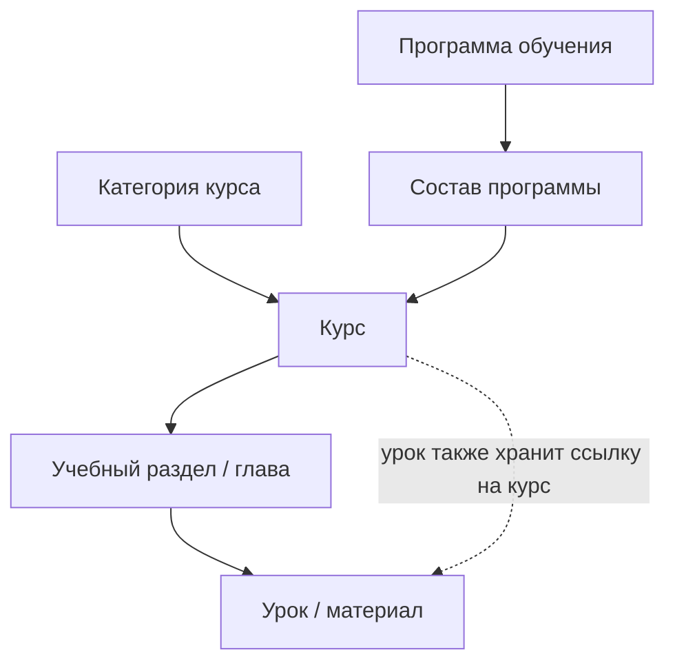
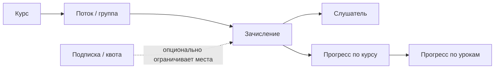
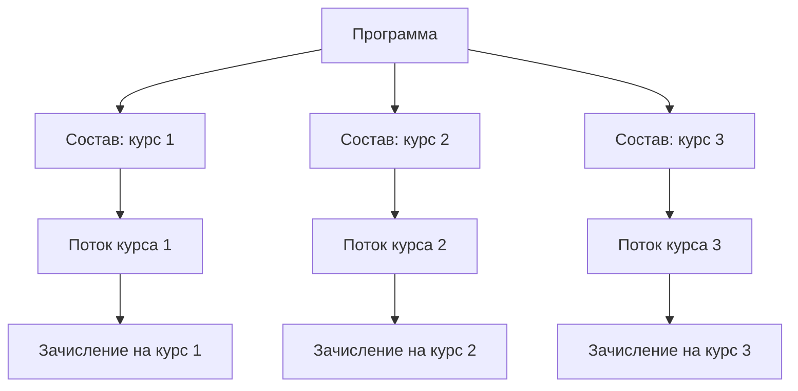
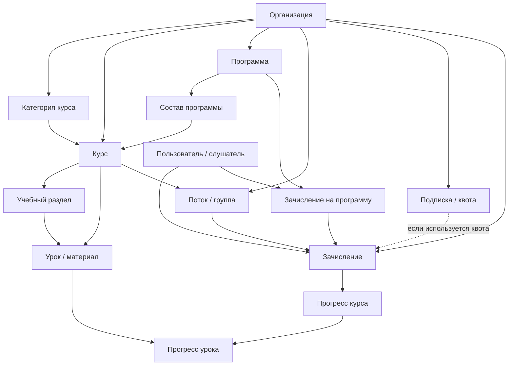
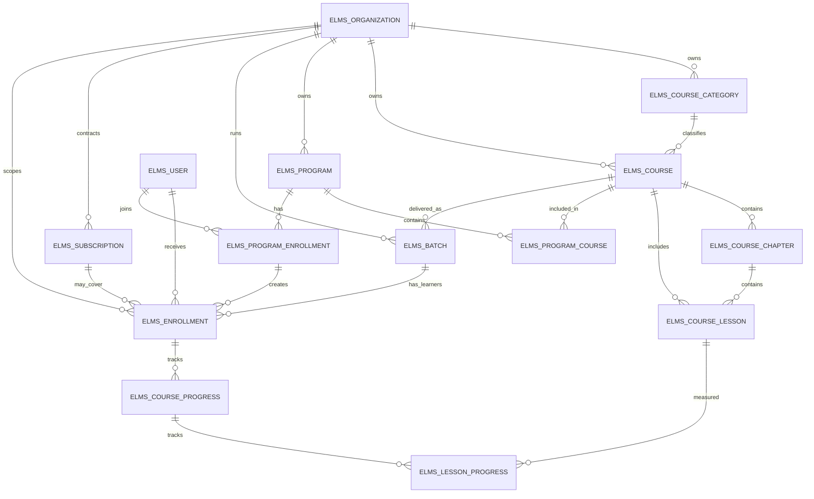

# Карта домена LMS: конструктор курсов и учебный процесс

**Дата:** 2026-11-16  
**Назначение:** объяснить связи между сущностями учебного контура ELMS.

## Главная модель

| Сущность | На какой вопрос отвечает |
|---|---|
| `ELMS Course Category` | Как сгруппировать курсы? |
| `ELMS Course` | Что изучать? |
| `ELMS Course Chapter` | Из каких разделов состоит курс? |
| `ELMS Course Lesson` | Какой конкретный материал изучать? |
| `ELMS Program` | В каком маршруте изучать несколько курсов? |
| `ELMS Program Course` | Какие курсы входят в программу и в каком порядке? |
| `ELMS Batch` | Когда, в какой группе и с каким куратором проходит курс? |
| `ELMS Subscription` | Сколько договорных мест можно выдать? |
| `ELMS Enrollment` | Кому конкретно выдан доступ к курсу? |
| `ELMS Program Enrollment` | На какую программу записан слушатель и какой курс текущий? |

Короткая цепочка:

```text
Контент:       Курс → Раздел → Урок
Маршрут:       Программа → Состав программы → Курсы
Организация:   Курс → Поток → Зачисление
Доступ:        Подписка → Квота → Зачисление
Результат:     Зачисление → Прогресс
```

## Иерархия содержания



Категория — это классификация, а не обязательный уровень иерархии: поле
`category` у курса может быть пустым. Раздел всегда принадлежит курсу. Урок
обязан ссылаться на курс, а ссылка на раздел может быть пустой.

Пример:

```text
Категория: Охрана труда
└── Курс: Охрана труда для руководителей
    ├── Раздел 1. Общие положения
    │   ├── Урок 1. Введение
    │   └── Урок 2. Законодательство
    └── Раздел 2. Безопасность
        ├── Урок 3. Основные риски
        └── Урок 4. Проверка знаний
```

## Программа и состав программы

`ELMS Program` не является большим курсом и не содержит копии уроков. Это
учебный маршрут из существующих курсов. `ELMS Program Course` — связующая
сущность, в которой хранятся курс, порядковый номер и обязательность.

```text
Программа «Специалист по охране труда»
├── 1. Основы охраны труда
├── 2. Управление рисками
└── 3. Итоговая проверка
```

Один курс может входить в несколько программ:

```text
Программа А ─┬─ Курс 1
             └─ Курс 2

Программа Б ─┬─ Курс 2
             └─ Курс 3
```

Если у программы включён `enforce_course_order`, следующий курс открывается
после завершения предыдущего.

## Поток, подписка и зачисление



### Поток (`ELMS Batch`)

Поток — конкретный запуск одного курса. Он хранит курс, даты, статус,
организацию и преподавателя/куратора.

```text
Курс: Охрана труда
└── Поток: ОТ-2026-01
    ├── 01.12.2026 — 20.12.2026
    ├── Куратор: Иванов
    └── Слушатели потока
```

У одного курса может быть много потоков: январский, февральский, вечерний,
корпоративный и т. д.

### Подписка (`ELMS Subscription`)

Подписка — договорная квота, а не учебный материал и не группа. Например:

```text
Организация: ООО «Газпром»
Договор: № 15
Курс: Охрана труда
Всего мест: 100
Использовано: 37
```

При зачислении через подписку сервер проверяет её статус и сравнивает
`seats_used` с `total_seats`, затем увеличивает использованную квоту. Подписка
может не использоваться для открытого self-enrollment.

В текущей схеме поле подписки технически ссылается на `ELMS Course`, хотя в
интерфейсе может называться «Курс / Программа». Для программы квота применяется
через отдельные зачисления на курсы программы.

### Зачисление (`ELMS Enrollment`)

Зачисление — центральная операционная запись:

```text
Слушатель + Поток + Курс + (опционально Подписка)
```

Оно даёт человеку доступ к обучению и является основанием для прогресса.
Зачисление на программу дополнительно связывается с
`ELMS Program Enrollment`.

## Программа в учебном процессе



Зачисление на программу не заменяет зачисления на курсы:

```text
Program Enrollment
├── Enrollment на курс 1
├── Enrollment на курс 2
└── Enrollment на курс 3
```

Система сначала создаёт зачисление на первый курс. Следующее зачисление
создаётся, когда слушателю разрешён следующий курс и для него найден активный
поток.

## Полная схема зависимостей



## ERD связей



## Влияние изменений

| Изменение | Эффект |
|---|---|
| Изменить категорию | Меняется группировка и фильтрация курса |
| Изменить курс | Его разделы, уроки, потоки и зачисления используют тот же курс |
| Добавить раздел или урок | Меняется учебная структура и расчёт прогресса |
| Изменить состав программы | Меняется маршрут, но курсы не дублируются |
| Создать поток | Появляется конкретный запуск курса с датами и группой |
| Изменить даты потока | Меняется доступность обучения его слушателям |
| Создать подписку | Появляется договорная квота мест |
| Создать зачисление | Конкретный слушатель получает доступ через поток |
| Завершить уроки | Обновляются прогресс урока и прогресс курса |
| Завершить курс программы | Может открыться следующий курс |

## Главная цепочка для пользователя

```text
Методист создаёт курс
→ добавляет разделы и уроки
→ оператор создаёт поток
→ при необходимости создаёт подписку с квотой
→ слушателя зачисляют в поток
→ слушатель изучает уроки
→ система считает прогресс
→ после завершения открывает следующий курс программы
```

Организация на LMS-сущностях задаёт границу владельца/издателя или заказчика.
Она не означает, что все члены организации автоматически являются слушателями:
аудитория обучения определяется записями `ELMS Enrollment`.
